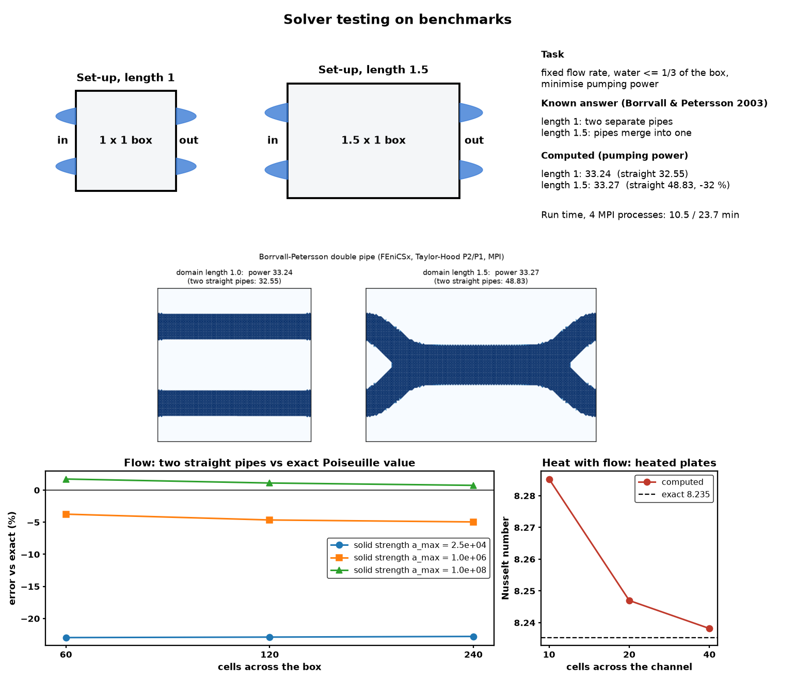

# FEniCSx Brinkman-Flow & Thermal Topology Optimisation (FEM · symbolic adjoint · PETSc · MPI)

Density-based topology optimisation of fluid and thermal-fluid devices with **finite elements in FEniCSx
(DOLFINx 0.11)**. Every linear system is solved with **PETSc**, either directly (MUMPS) or with
**scalable iterative solvers** (algebraic multigrid and a Schur-complement block preconditioner), and the whole
optimisation (state solves, adjoints, PDE filter and MMA) runs **in parallel with MPI**: 13× faster on 28 cores. Gradients come from the **discrete adjoint
generated symbolically from the UFL weak forms**, so no derivative is coded by hand.

This is the finite-element successor to the
[cold-plate project](https://github.com/venu131995/coldplate-topology-optimisation). Its Darcy model had no
viscous wall friction. The Stokes–Brinkman model here does, which changes the physics of the trade-off.


*`figures/thermal_optimisation_movie.mp4`: the channel network forming in a pressure-driven cold plate with an
8× hotspot (FEniCSx, 4 MPI processes).*

## Model

| | Equation | Discretisation |
|---|---|---|
| Flow (Stokes–Brinkman) | α(ρ)u − μΔu + ∇p = 0,  ∇·u = 0 | Taylor–Hood P2/P1 (inf-sup stable) |
| Heat (convection–diffusion) | Pe u·∇T − ∇·(k(ρ)∇T) = Q | P1 + SUPG stabilisation |
| Design filter | −r²Δx̃ + x̃ = x | Helmholtz PDE filter, P1 (parallel-friendly) |
| Interpolation | α = α_max q(1−ρ)/(q+ρ),  ρ = H_β(x̃) | Borrvall–Petersson, smoothed Heaviside |

- **Adjoint.** `ufl.adjoint(ufl.derivative(R, w))` gives each adjoint operator, and the chain rule runs through
  heat → flow → projection → filter. For the coupled thermal problem this means two adjoint solves (heat, then
  flow forced by the heat equation's velocity dependence) plus a filter adjoint.
- **Optimiser.** MMA with one global volume constraint, written to work in parallel. Each process updates only
  its own cells, and the dual problem's sums are MPI reductions, so results do not depend on the process count
  (tests run on 1 and 4 processes).
- **Continuation.**
  - The Brinkman parameter starts soft (q = 0.01 → 0.1), so channels can explore merging.
  - Projection sharpness rises from β = 1 to 32.
  - Solid permeability is high enough (α_max = 10⁶) that metal is effectively impermeable (see *Pitfalls found*).

## Results

### 1. Solver testing on benchmarks



**Flow optimisation: Borrvall–Petersson (2003) double pipe.** Two parabolic inflows and outflows, fixed flow rate,
water ≤ ⅓ of the box, minimise pumping (dissipated) power. Known answer: a short box keeps two pipes, a long box
merges them into one. Run on 4 MPI processes (`scripts/run_double_pipe.py`, one MPI job per length, then
`scripts/combine_double_pipe.py`; `results/double_pipe.json`):

| Domain length | Optimised topology | Pumping power | Two straight pipes | Exact (straight) | Run time |
|---|---|---|---|---|---|
| 1.0 | two separate pipes | 33.24 | 32.55 | 32 | 10.5 min |
| **1.5** | **pipes merge into one** | **33.27** | 48.83 (**−32%**) | 48 | 23.7 min |

**Accuracy against theory: straight pipes vs. the exact Poiseuille value** (`scripts/straight_pipe_accuracy.py`;
J = 32 L for two pipes of width 1/6 with impermeable walls). The Brinkman "solid" lets flow penetrate about
1/√α_max, so the error is set by the solid strength, not the mesh:

| α_max | 60 cells | 120 cells | 240 cells |
|---|---|---|---|
| 2.5 × 10⁴ (textbook value) | −23.0% | −22.9% | −22.8% |
| 10⁶ | −3.7% | −4.6% | −5.0% |
| **10⁸ (used for the benchmark)** | **+1.7%** | **+1.1%** | **+0.7%** |

The optimiser therefore runs with the textbook α_max (the soft start needed to find the merged pipe) and raises
it to 10⁶ and then 10⁸ once the design is crisp; both designs are reported at the same sharpness (β = 64).

**Heat with flow: heated parallel plates** (`scripts/verify_nusselt.py`, `results/nusselt.json`). The production
`ThermalPlate` solver on an all-fluid design, both walls heated with a uniform flux. The flow must be plane
Poiseuille and the developed Nusselt number (D_h = 2H) must equal 140/17 = 8.235 (Shah & London):

| Cells across | Nusselt | Error | Mean speed error | Mass balance | Energy balance (global) | Heat residual (local, nodal) |
|---|---|---|---|---|---|---|
| 10 | 8.285 | 0.61% | 2 × 10⁻¹² % | 5 × 10⁻¹⁴ | 2 × 10⁻¹⁴ | 3 × 10⁻¹³ |
| 20 | 8.247 | 0.14% | 4 × 10⁻¹² % | 9 × 10⁻¹⁴ | 4 × 10⁻¹⁴ | 1 × 10⁻¹² |
| 40 | **8.238** | **0.03%** | 9 × 10⁻¹² % | 2 × 10⁻¹³ | 7 × 10⁻¹⁴ | 5 × 10⁻¹² |

No standard thermal-fluid *optimisation* benchmark with a known answer exists, so the coupled optimiser is
verified in pieces: the flow-optimisation benchmark above, this coupled heat-flow solve, the manufactured
solutions and the Taylor gradient tests below.

### 2. Thermal cold plate (pressure-driven, 8× hotspot, 35% coolant)

| Design (identical final coolant fraction 34.8%) | Hotspot T_max | Flow at fixed Δp | Leakage through solid |
|---|---|---|---|
| Best straight channels (6 channels, 3.8 cells wide) | 0.0711 | 0.169 | 1.4% |
| **Topology-optimised** | **0.0350 (−51%)** | 0.347 | 0.6% |

- **Viscous friction gives straight channels a real optimum.** At a fixed pressure drop, more and narrower channels
  choke the flow: 1.35 → 0.045 from 2 to 12 channels. Six channels are best (`fig3_straight_channel_tradeoff.png`).
  The Darcy model in the earlier project could not capture this.
- **The optimised network** uses two wide, low-friction inlet trunks (twice the flow of the best straight design at
  the same Δp) that branch into a dense mesh of channels over the hotspot (`fig2_thermal_design.png`).
- **Fair baselines.** Every straight design has its width bisected so that, after the *same* filter and projection
  pipeline, its coolant fraction equals the optimised design's.

### 3. Verification and confidence

**Manufactured solutions** (`scripts/verify_mms.py`, exact solution with derived sources; `fig4_mms_convergence.png`):

| Field | Norm | Observed rate | Theory |
|---|---|---|---|
| velocity | L2 | **3.00** | 3 (P2) |
| velocity | H1 | **2.00** | 2 |
| pressure | L2 | **2.02** | 2 (P1) |
| temperature (SUPG) | L2 | **2.06** | 2 |
| temperature | H1 | **1.00** | 1 |

**Conservation on the final optimised design** (`conservation()` in `model.py`, all from `results/thermal.json`):

| Law | Global | Local |
|---|---|---|
| Mass | inflow = outflow to 2 × 10⁻¹⁴ | max cell ∫∇·u = 0.18% of throughflow (Taylor–Hood is not pointwise divergence-free) |
| Momentum | inlet pressure force = Brinkman drag + wall friction to 0.2% (discretisation error, shrinks with mesh) | nodal residual of every momentum/continuity equation: 10⁻¹⁷ |
| Mechanical energy | pumping power = viscous + Brinkman dissipation to 2.5 × 10⁻¹⁴ | – |
| Thermal energy | chip heat = heat advected out + conducted into the inlet to 1 × 10⁻¹³ | nodal heat residual: 10⁻¹² |

**Gradients:** Taylor tests show second-order remainder convergence (rate > 1.8) for both problems, in serial
and on 4 MPI processes.

### 4. MPI scaling: direct vs. iterative solvers

`Settings(solver="lu")` (default) factorises every system with MUMPS. `Settings(solver="iterative")` uses solvers
that need no factorisation:

| System | Krylov method | Preconditioner | Iterations |
|---|---|---|---|
| Helmholtz filter and its adjoint (SPD) | CG | BoomerAMG (hypre) | 6–7 |
| Heat and heat adjoint (SUPG, Pe = 10³) | GMRES | BoomerAMG | 14–21 |
| Stokes–Brinkman and flow adjoint | FGMRES | fieldsplit Schur (upper), S ≈ −B diag(A)⁻¹Bᵀ ("selfp"), BoomerAMG on both blocks | 41 / 76 / 138 |

Both solvers give the same objective to 9 digits and the same gradient (tested). Strong scaling of one full
optimisation step (flow, heat, two adjoints, filter and filter adjoint) on the six-channel design
(α_max = 10⁶, sharp solid/fluid contrast), one thread per process, 2 × 14-core Xeon E5-2690 v4 server
(`scripts/scaling.py`, `results/scaling.json`). Seconds per step:

| MPI processes | 1 | 2 | 4 | 8 | 16 | 28 | speed-up 1 → 28 |
|---|---|---|---|---|---|---|---|
| 80,000 cells (0.4 M unknowns), MUMPS | 13.6 | 11.0 | 8.1 | 7.3 | 6.8 | 6.6 | 2.1× |
| 80,000 cells, iterative | 25.3 | 13.6 | 7.5 | 5.2 | 3.9 | **2.5** | **10×** |
| 320,000 cells (1.6 M unknowns), MUMPS | 63.6 | 48.9 | 38.0 | 32.2 | 29.6 | 28.1 | 2.3× |
| 320,000 cells, iterative | 264 | 137 | 73.9 | 49.0 | 37.1 | **20.4** | **13×** |

- **MUMPS stops scaling after about 4 processes.** The factorisation is limited by memory bandwidth and by its
  sequential parts.
- **The iterative solvers keep scaling** and overtake MUMPS from 4 processes on: 2.6× faster at 28 processes on the
  smaller mesh and 1.4× on the larger one. The larger mesh scales better (more work per process).
- **Open issue: flow iterations grow with refinement** (41 → 76 → 138 for 20k → 80k → 320k cells), so on one
  process the iterative flow solve is 4× slower than MUMPS on the large mesh. The "selfp" Schur approximation uses
  the diagonal of the P2 velocity block, which is not spectrally equivalent in the Stokes (fluid) regions. Tested
  and rejected: a weighted pressure mass matrix (> 1,000 iterations), a mass + Darcy-Laplacian approximation and a
  lumped velocity inverse (both slower). A Brinkman-robust Schur preconditioner (sum of a scaled pressure mass
  inverse and a Darcy-Laplacian inverse, applied as a shell) is the next step.

## Pitfalls found and fixed (worth knowing for real use)

1. **Leaky solid.** With the textbook α_max = 2.5 × 10⁴ and a large pressure drop, about ⅓ of the coolant seeped
   through "metal", and an all-solid plate still carried 30% as much flow as six open channels. The optimiser
   exploited this with dead-end channels feeding porous solid. Fixed with α_max = 10⁶ (leakage ~1%), reported
   for every design and guarded by a unit test.
2. **Quadrature mismatch.** UFL picks quadrature automatically, and the SUPG term's square root gave the solve and
   the residual check different rules. A fixed quadrature degree makes discrete residuals reach round-off.
3. **Ill-conditioned convection solves.** Iterative refinement on the MUMPS factorisation restores lost digits.
4. **Local optima.** Soft-start Brinkman continuation was needed to reproduce the merged double pipe.
5. **Textbook α_max is too leaky for accurate numbers.** With α_max = 2.5 × 10⁴ the straight-pipe dissipation is
   23% below the exact value at every mesh. Raising α_max to 10⁸ after the design is crisp brings it within 2%.
   Raising it while the design is still grey froze the layout, so the ramp starts only at full sharpness.
6. **Hidden state between runs.** Running both double-pipe lengths in one MPI job sent the second one into the
   two-pipe local optimum (the same run alone merges). Each length now runs in its own job.

## Limitations

- Stokes–Brinkman, not full Navier–Stokes: no inertia. This is valid for laminar microchannels at low Reynolds
  number.
- 2-D plan-view, dimensionless and steady. The 3-D conjugate heat transfer of a real cold plate is the next step,
  and the same code extends to 3-D meshes.
- The thermal study uses α_max = 10⁶, where the straight-pipe check shows dissipation 4–5% below exact. Designs
  are compared within the same model, but absolute values carry that error; 10⁸ is the accurate setting.
- The iterative flow solver's iteration count grows with mesh refinement (see MPI scaling). Large 3-D runs need a
  mesh-robust Brinkman Schur preconditioner.

## Run

```bash
micromamba create -n fx -c conda-forge python=3.12 "fenics-dolfinx=0.11" "mpi=*=openmpi" matplotlib scipy pytest imageio-ffmpeg
python -m pytest -q tests                          # 9 tests (also: mpirun -n 4 python -m pytest tests)
python scripts/verify_mms.py                       # manufactured-solution rates, ~1 min
mpirun -n 4 python scripts/run_double_pipe.py 1.0  # benchmark, short box, ~11 min
mpirun -n 4 python scripts/run_double_pipe.py 1.5  # long box, ~24 min (separate job)
python scripts/combine_double_pipe.py              # merge both into double_pipe.json and fig1
mpirun -n 4 python scripts/straight_pipe_accuracy.py  # straight pipes vs exact, ~2 min
python scripts/verify_nusselt.py                   # heated plates, Nusselt vs 8.235, ~20 s
python scripts/plot_benchmark.py                   # fig0_benchmark.png
mpirun -n 4 python scripts/run_thermal.py          # thermal design + fair baselines, ~25 min
mpirun -n N python scripts/scaling.py 200 iterative  # strong scaling, lu or iterative (see script header)
python scripts/make_animation.py                   # movie
```

`src/fxtopopt/`:
- `model.py`: weak forms, symbolic adjoints, PDE filter, direct and iterative PETSc solvers, conservation checks;
- `mma.py`: parallel MMA;
- `optimise.py`: loop with continuation.
