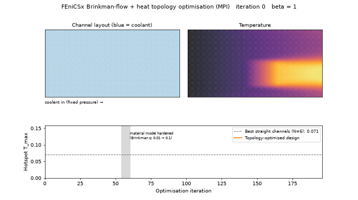

# FEniCSx Brinkman-Flow & Thermal Topology Optimisation (FEM · symbolic adjoint · PETSc · MPI)

Density-based topology optimisation of fluid and thermal-fluid devices with **finite elements in FEniCSx
(DOLFINx 0.11)**. Every linear system is solved with **PETSc** (MUMPS), and the whole optimisation (state
solves, adjoints, PDE filter and MMA) runs **in parallel with MPI**. Gradients come from the **discrete adjoint
generated symbolically from the UFL weak forms**, so no derivative is coded by hand.

This is the finite-element successor to the
[cold-plate project](https://github.com/venu131995/coldplate-topology-optimisation). Its Darcy model had no
viscous wall friction. The Stokes–Brinkman model here does, which changes the physics of the trade-off.



*`figures/thermal_optimisation_movie.mp4`: the channel network forming in a pressure-driven cold plate with an
8× hotspot (FEniCSx, 4 MPI processes).*

## Model

| | Equation | Discretisation |
|---|---|---|
| Flow (Stokes–Brinkman) | α(ρ)u − μΔu + ∇p = 0,  ∇·u = 0 | Taylor–Hood P2/P1 (inf-sup stable) |
| Heat (convection–diffusion) | Pe u·∇T − ∇·(k(ρ)∇T) = Q | P1 + SUPG stabilisation |
| Design filter | −r²Δx̃ + x̃ = x | Helmholtz PDE filter, P1 (parallel-friendly) |
| Interpolation | α = α_max q(1−ρ)/(q+ρ),  ρ = H_β(x̃) | Borrvall–Petersson, smoothed Heaviside |

- **Adjoint.** `ufl.adjoint(ufl.derivative(R, w))` gives each adjoint operator, and the chain rule runs through
  heat → flow → projection → filter. For the coupled thermal problem this means two adjoint solves (heat, then
  flow forced by the heat equation's velocity dependence) plus a filter adjoint.
- **Optimiser.** MMA with one global volume constraint, written to work in parallel. Each process updates only
  its own cells, and the dual problem's sums are MPI reductions, so results do not depend on the process count
  (tests run on 1 and 4 processes).
- **Continuation.**
  - The Brinkman parameter starts soft (q = 0.01 → 0.1), so channels can explore merging.
  - Projection sharpness rises from β = 1 to 32.
  - Solid permeability is high enough (α_max = 10⁶) that metal is effectively impermeable (see *Pitfalls found*).

## Results

### 1. Benchmark: Borrvall–Petersson double pipe (minimum dissipated power, ⅓ fluid)

| Domain length | Optimised topology | Dissipated power | Two straight pipes |
|---|---|---|---|
| 1.0 | two separate pipes | 21.98 | 24.65 |
| **1.5** | **pipes merge into one** | **23.95** | 36.73 (**−35%**) |

This reproduces the classic Borrvall & Petersson (2003) result: when the domain is long enough, two pipes cost
more viscous dissipation than one merged channel (`fig1_double_pipe.png`). The first run without q-continuation
got stuck in the two-pipe local optimum. The soft-start continuation used in the reference literature fixes it.

### 2. Thermal cold plate (pressure-driven, 8× hotspot, 35% coolant)

| Design (identical final coolant fraction 34.8%) | Hotspot T_max | Flow at fixed Δp | Leakage through solid |
|---|---|---|---|
| Best straight channels (6 channels, 3.8 cells wide) | 0.0711 | 0.169 | 1.4% |
| **Topology-optimised** | **0.0350 (−51%)** | 0.347 | 0.6% |

- **Viscous friction gives straight channels a real optimum.** At a fixed pressure drop, more and narrower channels
  choke the flow: 1.35 → 0.045 from 2 to 12 channels. Six channels are best (`fig3_straight_channel_tradeoff.png`).
  The Darcy model in the earlier project could not capture this.
- **The optimised network** uses two wide, low-friction inlet trunks (twice the flow of the best straight design at
  the same Δp) that branch into a dense mesh of channels over the hotspot (`fig2_thermal_design.png`).
- **Fair baselines.** Every straight design has its width bisected so that, after the *same* filter and projection
  pipeline, its coolant fraction equals the optimised design's.

### 3. Verification and confidence

**Manufactured solutions** (`scripts/verify_mms.py`, exact solution with derived sources; `fig4_mms_convergence.png`):

| Field | Norm | Observed rate | Theory |
|---|---|---|---|
| velocity | L2 | **3.00** | 3 (P2) |
| velocity | H1 | **2.00** | 2 |
| pressure | L2 | **2.02** | 2 (P1) |
| temperature (SUPG) | L2 | **2.06** | 2 |
| temperature | H1 | **1.00** | 1 |

**Conservation on the final optimised design** (`conservation()` in `model.py`, all from `results/thermal.json`):

| Law | Global | Local |
|---|---|---|
| Mass | inflow = outflow to 2 × 10⁻¹⁴ | max cell ∫∇·u = 0.18% of throughflow (Taylor–Hood is not pointwise divergence-free) |
| Momentum | inlet pressure force = Brinkman drag + wall friction to 0.2% (discretisation error, shrinks with mesh) | nodal residual of every momentum/continuity equation: 10⁻¹⁷ |
| Mechanical energy | pumping power = viscous + Brinkman dissipation to 2.5 × 10⁻¹⁴ | – |
| Thermal energy | chip heat = heat advected out + conducted into the inlet to 1 × 10⁻¹³ | nodal heat residual: 10⁻¹² |

**Gradients:** Taylor tests show second-order remainder convergence (rate > 1.8) for both problems, in serial
and on 4 MPI processes.

### 4. MPI scaling

One full optimisation step (flow solve, heat solve, two adjoints and the filter) on an 80,000-cell mesh, measured
fairly with one thread per process and MUMPS parallel ordering (`scripts/scaling.py`, `results/scaling.json`):

| MPI processes | 1 | 2 | 4 |
|---|---|---|---|
| Seconds per step | 9.4 | 7.5 | 7.1 |
| Speed-up | 1.00 | 1.25 | 1.32 |

The code is genuinely parallel: the mesh, assembly, solves and MMA are distributed, and results are identical
across process counts. Speed-up on a laptop is modest because every solve uses the sparse **direct** solver
(MUMPS), whose factorisation is limited by memory bandwidth on 4 performance cores. A naive test that let one process
use multi-threaded BLAS even showed a slow-down. The scalable path is iterative solvers: algebraic multigrid
(hypre) for the heat equation and a PETSc fieldsplit/Schur-complement preconditioner for Stokes–Brinkman. That is
the change needed before large 3-D runs on a cluster.

## Pitfalls found and fixed (worth knowing for real use)

1. **Leaky solid.** With the textbook α_max = 2.5 × 10⁴ and a large pressure drop, about ⅓ of the coolant seeped
   through "metal", and an all-solid plate still carried 30% as much flow as six open channels. The optimiser
   exploited this with dead-end channels feeding porous solid. Fixed with α_max = 10⁶ (leakage ~1%), reported
   for every design and guarded by a unit test.
2. **Quadrature mismatch.** UFL picks quadrature automatically, and the SUPG term's square root gave the solve and
   the residual check different rules. A fixed quadrature degree makes discrete residuals reach round-off.
3. **Ill-conditioned convection solves.** Iterative refinement on the MUMPS factorisation restores lost digits.
4. **Local optima.** Soft-start Brinkman continuation was needed to reproduce the merged double pipe.

## Limitations

- Stokes–Brinkman, not full Navier–Stokes: no inertia. This is valid for laminar microchannels at low Reynolds
  number.
- 2-D plan-view, dimensionless and steady. The 3-D conjugate heat transfer of a real cold plate is the next step,
  and the same code extends to 3-D meshes.
- MUMPS direct solves limit scaling. Large 3-D problems need iterative block preconditioners (PETSc fieldsplit).

## Run

```bash
micromamba create -n fx -c conda-forge python=3.12 "fenics-dolfinx=0.11" "mpi=*=openmpi" matplotlib scipy pytest imageio-ffmpeg
python -m pytest -q tests                          # 7 tests (also: mpirun -n 4 python -m pytest tests)
python scripts/verify_mms.py                       # manufactured-solution rates, ~1 min
mpirun -n 4 python scripts/run_double_pipe.py      # benchmark, ~18 min
mpirun -n 4 python scripts/run_thermal.py          # thermal design + fair baselines, ~25 min
mpirun -n N python scripts/scaling.py 200          # strong scaling (see script header for fair settings)
python scripts/make_animation.py                   # movie
```

`src/fxtopopt/`:
- `model.py`: weak forms, symbolic adjoints, PDE filter, conservation checks;
- `mma.py`: parallel MMA;
- `optimise.py`: loop with continuation.
